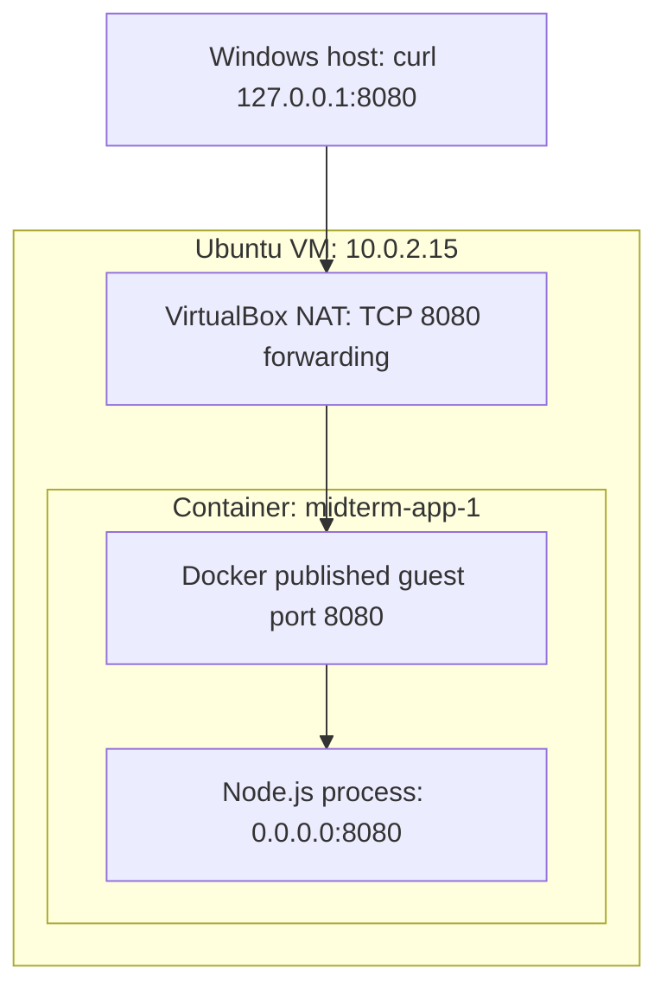

# CS 554 — One Service, Two Deployment Environments

### Deployment layers and request path

My physical computer runs Windows and VirtualBox. VirtualBox runs the Ubuntu VM, which has its own guest kernel. Inside Ubuntu, Docker Engine runs the container, and the Node.js process inside that container shares the guest kernel. The container provides isolation within that operating system, while the VM provides a full operating-system boundary.

A request from the host starts at Windows loopback port 8080. VirtualBox's forwarding rule sends it to guest port 8080, and Docker's published port passes it to the application. From inside the VM, curl can access guest loopback port 8080 directly. Both `/` and `/health` returned HTTP 200 from the host and from inside the VM. The logs showed the request paths and status codes.

My kind cluster runs separately on Windows through Docker Desktop. Its node is a container in Docker Desktop's Linux environment, so it does not run inside the Ubuntu VirtualBox VM. A Deployment manages two application Pods. A ClusterIP Service gives them an internal address and port that do not depend on individual Pod names. During my tests, the Service address was 10.96.124.196:80. This address is only available within the cluster and can change if the Service is recreated.

### Compose and Kubernetes observations

In the final Compose deployment, I restarted `app` and saw the request count change from 3 to 1. The hostname stayed `305e5bcc9765` because Compose restarted the existing container. The counter is held by the Node process and is lost when that process starts again. It is temporary and is not shared with other instances.

For the Pod deletion experiment, the Deployment still specified two replicas. After I deleted the Pod ending `6n45l`, a replacement ending `bc4zd` appeared, while the other Pod stayed in place. The Deployment/ReplicaSet controllers brought the actual number of replicas back to the desired count. The replacement Pod had a new identity and a new application process. With Compose, my restart command restarted the existing service container. It did not show a controller replacing a deleted replica to maintain a declared replica count. Both Kubernetes replicas run on the same node in this local cluster, so this test does not establish availability if that node fails.

### Controlled troubleshooting

I introduced the fault by changing the Service selector from `app=midterm-app` to `app=wrong-app`. The Deployment stayed healthy and both Pods remained ready, but their labels were still `app=midterm-app`. When I inspected the Service, it had no matching endpoints. Running wget inside the cluster against `http://midterm-service/` returned connection refused and exit code 1. Together, these results showed that the problem was in the discovery/routing configuration rather than the application.

After I restored `app=midterm-app`, the endpoints returned and a request through the Service produced a successful JSON response. Having healthy Pods was not enough to establish connectivity: the Service also needed matching labels and eligible backends. I used the Service DNS name because a direct request to a Pod would have bypassed the incorrect selector. I stopped port-forwarding before running this test.

### Resources and HTTP readiness

Each application container requests 100 millicores of CPU and 64 MiB of memory. Its limits are 500 millicores and 128 MiB. I chose these as modest starting values for a small HTTP service with no external dependencies; they were not based on load testing. Requests help the scheduler determine whether a node has enough allocatable resources, but they do not mean the application uses that amount continuously. The CPU limit caps CPU time and may cause throttling. Going over the memory limit can cause an out-of-memory termination. Setting the limits above the requests leaves room for short bursts and runtime overhead.

The HTTP readiness probe checks `/health` on port 8080 every three seconds. It has a two-second timeout, and one failed check marks the container unready. At the start, both Pods were ready and both EndpointSlice entries were eligible for traffic. I created `/tmp/not-ready` only in Pod `midterm-app-5d7b5ff49f-5hz7l`. Its health endpoint then returned 503, although a direct request to `/` still returned JSON. The Pod stayed Running with zero restarts, and the other replica remained ready.

The affected endpoint changed to ready=False, while the other stayed ready=True. All five requests through the in-cluster Service reached the healthy Pod ending `zs6lj`. After I removed the file, health returned HTTP 200, both Pods became ready, and both endpoint entries returned to ready=True. This showed that readiness controls eligibility for new Service traffic without restarting the process. I had no liveness probe configured, and I did not crash or delete either Pod during this experiment.

### OpenStack deployment analysis

To deploy this service on an instructor-provided OpenStack cloud, I would use an Ubuntu Server 24.04 image, a modest flavor with two virtual CPUs and 2 GB RAM, and a root disk of about 20 GB. These would be reasonable starting resources for one small Node.js container and Docker Engine, depending on the available flavors and quotas. I would choose a trusted Ubuntu image already available through Glance. The CirrOS demonstration image is intended for lightweight cloud testing. I would create or import an SSH public key pair and keep the private key outside the repository. [1, 2]

Within my project, I would create a tenant network and subnet if they had not already been supplied. I would attach the subnet to a router and connect that router to the external network provided by the administrator. I would also create an application security group, allocate a floating IP from the available external pool, and associate it with the instance's network port. The administrator normally provides the working cloud services, hypervisor capacity, external connectivity, images, flavors, and project quotas. My permissions would determine which project resources I could create. If a network topology had already been assigned, I would reuse it instead of creating duplicates. [1]

Keystone authenticates my account and authorizes API requests within my project. Glance supplies the operating-system image I select. Nova handles instance creation and scheduling, checks resource availability through Placement, and directs the compute host to start the guest. Neutron provides the instance port, virtual networks, router connectivity, security groups, and floating-IP association. Once the VM is available, I would SSH into Ubuntu, install Docker Engine and Compose, transfer the project and the same `cs554-midterm:1.1` image archive, load it, and run `docker compose up -d --no-build`. OpenStack would manage the VM infrastructure, while Compose would manage the application container inside the guest. [1]

This workload does not need a separate Cinder data volume. The request counter is intentionally local to the process and resets on restart. Saving or synchronizing it would change the experiment. The VM still needs a root disk for its operating system, Docker image, configuration, and logs. If the cloud requires boot-from-volume, that root volume would meet the VM's boot requirements rather than store durable application data. [1]

An external client would send its HTTP request to the floating IP on TCP port 8080. Neutron's floating-IP translation and router connectivity would deliver the request to the instance's fixed address, subject to the security-group controls. The guest firewall must allow the traffic, Docker must publish guest port 8080, and Node must listen on container port 8080 on all interfaces. I would allow TCP 8080 from the intended client address or subnet. SSH would use a separate TCP 22 rule, preferably restricted to my management address. Optional ICMP rules would allow ping, but they would not allow HTTP. A successful ping alone would not show that the application works. [1]

If the VM was running but an external client could not reach it, I would begin inside the guest. I would check Compose status and logs, then use curl on both endpoints through guest loopback. If these requests failed, I would check the container state, environment variables, application errors, and published ports. If local requests worked, I would check listening sockets, guest firewall rules, interface addresses, and routes. I would then check the instance port, attached security group, floating-IP association, router interfaces, and external gateway in Neutron. At each layer, I would collect evidence from client curl errors, guest logs, port mappings, and cloud resource status. Keystone, Glance, and Nova help set up the VM, but they do not carry each application HTTP request. [1]

The class debugging account shows why running a cloud involves more work than deploying an application into one. Placement appeared active but returned HTTP 500 because of an incompatible oslo.policy dependency. This affected Nova conductors and scheduling until the dependency and affected services were repaired. That was an infrastructure setup problem, separate from an incorrect application port inside a healthy VM. For this small service, a VM with Compose would be enough when manual operation is acceptable. In my experiments, Kubernetes added automatic Pod replacement and readiness-based Service eligibility. [2]

### Course references

[1] Course slides, OpenStack — Architecture.

[2] Course material, The OpenStack Lab That Turned Into a Systems Debugging Exercise, sections 13–15 and 17–18.

